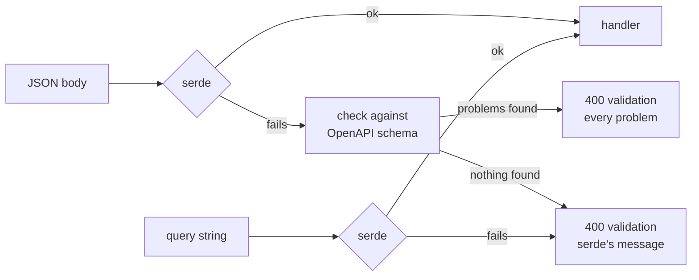
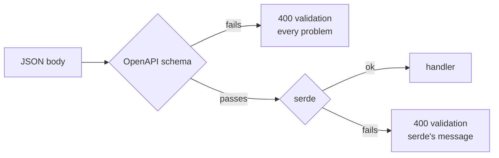
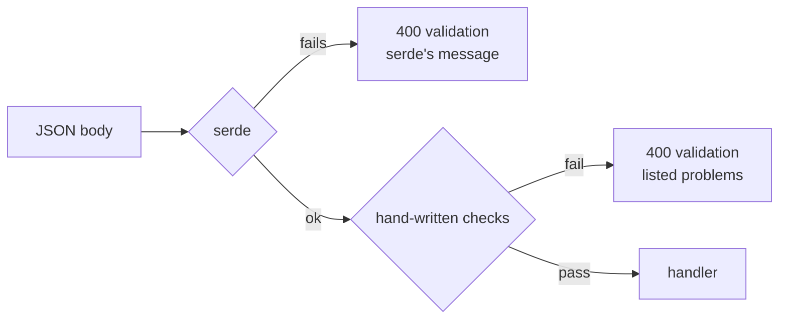
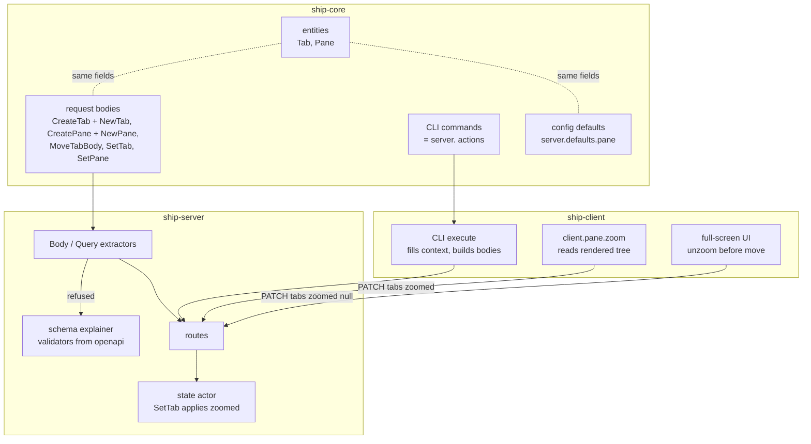

# Entity and request shapes: architecture

Status: Locked on 2026-10-25. Built on the locked `product.md`. Cyan picked shape A in chat ("yep i agree. that makes sense to me"), with the deciding outcome that a schema mistake can never reject a valid request. Revised the same day at Cyan's direction ("sounds good to me") so the SC-001 check is a one-off scratch program rather than a permanent test, then approved in Plannotator review ("LGTM"). Revised the same day after the product paper's FR-011 change (`client.pane.zoom` takes a `zoomed` switch), which Cyan approved in chat without a further review ("i don't have to cehck the other papers"). KD-10 revised the same day after program design found its premise wrong; Cyan approved the change in chat ("i agree with oyur deffaults on those questions").

## Superseding decision: unknown request fields

Cyan approved the product revision during slice 2 ("i see. let's drop it then and keep going"). The architecture remains shape A: serde gates, the generated schema explains only refusals. Request types no longer carry `deny_unknown_fields`, including input frames and the text query; config strictness is unchanged. This avoids utoipa's internally tagged enum schema contradiction between a closed payload and its separate tag, without handwritten schemas or frame-specific decoder dispatch. Earlier unknown-field rejection statements below are superseded history. Cyan's approval to drop the restriction and continue applies to this architecture revision and the program revision.

## Superseding decision: schema library

Cyan approved replacing `jsonschema` with `boon` during slice 2 ("Perfect! alright! keep going with boon for this slice then!"). Shape A and the wire contract are unchanged. This supersedes the original library-specific dependency, API and noise-filter details below; those remain as design history.

- Use `boon = "0.6.1"`. Compile the generated components once, lazily, into boon's `Schemas`. A `HashMap<String, SchemaIndex>` maps component names to compiled indices. Together these form the server-local `ValidatorMap`.
- Register one in-memory schema resource, explicitly select draft 2020-12 and compile the document's existing `#/components/schemas/{name}` references. No handwritten schema or external document fetching is needed.
- After serde refuses, look up the component index, validate, and traverse the error tree into `Problem` entries. Unwrap groups and references, suppress inapplicable shape alternatives when relevant alternatives remain, and give each missing property its own pointer. Error wording need not match jsonschema.
- `Body<T>`, `Query<T>`, `decode`, serde-path fallback and NDJSON handling keep their contracts. A schema must never reject a serde-accepted request.
- The scratch release comparison saved about 2.07 MB with boon and reduced added package entries from 25 to 7. All 69 component schemas compiled and live verification, including 44 null-field cases, passed. Exact measurements and final real-checkout verification are recorded in `tasks.md`.

Cyan's direction approves this architecture revision and the corresponding program revision. No product behavior changes beyond the previously approved unknown-field revision.

## Context and constraints

- **Wire types live in `ship-core`.** `protocol.rs` holds the request bodies and `model.rs` holds the entities, which are also the `get` output. The server, the CLI and the full-screen client all use these types, and utoipa derives the OpenAPI document from them.
- **Handlers take axum's `Json<T>` and `Query<T>`.** Nothing maps their rejections, so a bad body gets axum's plain-text 422 and a bad query gets plain-text 400. `move_tab` decodes its own body by hand (`routes.rs:149`) to turn a two-key body into a syntax error.
- **Only `SetTab` and `SetPane` reject unknown fields.** `CreatePane` flattens `PaneInput`, which flattens `PaneSpec`. serde can't combine `flatten` with `deny_unknown_fields`, and utoipa emits flattened types without `additionalProperties`.
- **A `server.` action is the CLI command at the same path** (`ship-client/src/keymap.rs:241`, `Action::Server` wraps the `ship-core` `Command`). Removing `ship pane zoom` therefore removes `server.pane.zoom` too.
- **Ship has no authored tests.** Verification is builds, Clippy, real workflows and temporary probes. A permanent test needs Cyan's agreement (`docs/agents/code.md`).
- **Own the domain, rent the mechanisms.** The implementation budget is about 20,000 lines of Rust.
- **The spike in `/tmp/ship-schema-spike` settled what the tools can do (macOS):**
  - All 13 body schemas compile with `jsonschema` 0.60.1, and none of 19 valid bodies was rejected.
  - Invalid bodies list every problem with a JSON Pointer, after two filters remove noise from optional fields and from tagged-enum variants that weren't sent.
  - `serde_with::rust::double_option` gives absent, `null` and value as three cases, and utoipa renders it as nullable without annotation.
  - A field marked `deserialize_with = "present"` (read `T`, wrap in `Some`) and `#[schema(nullable = false)]` rejects `null` in both serde and the schema.
  - `Switch` renders as `oneOf [boolean, {"enum": ["toggle"]}]`.
  - clap's `Option<Option<String>>` separates an absent flag, a bare `--name` and `--name ""`.

## Candidate shapes

### A. serde decides, the schema explains (winner)

serde stays the only judge of whether a body is valid. When it accepts, the handler runs and the schema never comes into it. When it refuses, the body is checked against its schema from the server's own OpenAPI document, and every problem found goes into one 400 `validation` error. If the schema finds nothing, because the schema and the type have drifted or because serde refused for a reason the schema can't express, the error carries serde's single message instead. Queries take the same error path without the schema step. The cost is one new runtime dependency (`jsonschema`, default features off) and a few lines of noise filtering. The failure mode is mild: a schema bug makes an error message less useful but never refuses a good request. Rolling back means swapping the extractors back to `Json<T>` and `Query<T>`.

### B. The schema gates every request

Every body is checked against its schema first, and serde only runs on bodies that pass. The error list is the same as A's. The difference is who decides: the schema becomes the contract, which suits external clients generated from the document. It costs a schema check on every request, including hot ones like `ViewInput` on every resize. The failure mode is serious: any drift between the derived schema and the serde type refuses valid requests, and utoipa's output is known to be approximate in places (flatten, untagged enums).

### C. Rust collects its own errors

No schema at runtime. Each request type gets checks written in Rust, through a validation crate such as `garde` or by hand, that collect every problem into a list. The document stays documentation only. Every rule is then written twice, once in the type and once in the checks. That cuts against "rent the mechanisms", and it still can't report problems serde trips on first, such as a wrong type or an unknown field, without extra machinery.

## Decision

Shape A. The outcome that matters most is that a schema mistake can never reject a valid request. A keeps serde as the only gate and uses the schema only to explain a refusal, so it beats B, where drift refuses good input, and C, which writes every rule twice and still can't list type errors.

## Structure

| Box | Owns |
| --- | --- |
| entities | The one shape of each entity, as `get` returns it. `name` becomes a plain optional string, stored as sent. |
| request bodies | One named type per body. Request fields sit at the top level, and the new entity sits under `pane` (`NewPane`) or `tab` (`NewTab`). No `flatten`. Every type rejects unknown fields. Every optional field that can't be empty rejects `null`. Clearable fields use `double_option`. `ZoomPane` is gone, and `SetTab` gains `zoomed`. |
| CLI commands | `ship tab set` gains `--zoomed`. Clearable flags are `Option<Option<T>>`. `ship pane zoom` is gone, and with it `server.pane.zoom`. |
| config defaults | Unchanged. Its keys already match `Pane`, apart from `shell`. |
| Body / Query extractors | Turn every decode failure into a 400 `validation` `AppError` with `data.errors: [{pointer, detail}]`. Queries always report one entry. This is the shared helper Cyan asked about. |
| schema explainer | Validators built once from `ship_server::openapi()`, keyed by schema name, plus the spike's two noise filters. It runs only on failure. |
| routes | Take bodies only through the extractors. `move_tab`'s hand decode goes away, and `POST /panes/{id}/zoom` goes away. |
| state actor | Applies `zoomed` from `SetTab`. A pane in another tab is `invalid_structure`, and an unknown pane is `not_found`. |
| CLI execute | Resolves context (attachment, `child`, current directory) and builds the nested bodies. |
| client.pane.zoom | Takes `zoomed`, a `Switch`, and resolves it against the tree it renders: the current value is whether the selected pane's tab is zoomed on it. `true` sends the pane's ID, `false` sends `{"zoomed": null}`. |
| full-screen UI | Unzooms before moving out of a zoomed pane with `{"zoomed": null}`. |

## Key decisions

1. **serde gates, the schema explains (shape A).** Rejected: B, where the schema gates and drift refuses valid requests, and C, which writes every rule twice in Rust.
2. **One error path for bodies and queries.** Both extractors produce the same `AppError` with the same `data.errors` list. Queries skip the schema step and report one entry, per FR-018. Rejected: listing every query problem, which needs query strings converted to typed JSON first and pays off on one route with three flat parameters. Also rejected: leaving queries to axum's plain-text rejection.
3. **Each input surface keeps its own struct, kept aligned by checking the OpenAPI document.** Create's `NewPane`, `SetPane` and `PaneDefaults` stay separate types because their value domains differ (plain values, `null` and `toggle`, no `null`). Rejected: one generic partial type parameterized by value wrapper, whose generics fight utoipa's schema naming. Also rejected: a partial-struct macro crate, which doesn't carry serde and utoipa attributes reliably and adds a dependency for about 15 fields.
4. **SC-001 is checked once, by a throwaway program outside the repo.** `ToSchema` describes each struct faithfully but doesn't compare structs with each other, so nothing in the build notices if `NewPane` renames or retypes a `Pane` field. During implementation, a scratch binary like the spike's loads `ship_server::openapi()`, compares every input field named like an entity field against that field's type, prints mismatches, and is deleted. It allows exactly two widenings: `toggle` on bools in PATCH, and `shell`. It is not part of Ship, never runs at runtime, and adds nothing to the build. Reusing the same field types (`ExitBehavior`, `usize`) already keeps most types aligned, so what's left to check is mostly names. Rejected: a permanent test in the repo, which Cyan declined, and no check at all.
5. **`null` is rejected per field, in serde and the schema together.** Each optional field that can't be empty carries `present` and `nullable = false`, in every request body, not only PATCH. One small function, no new dependency. Rejected: a crate-wide serde setting (none exists), and a custom wrapper type for every field, which would need its own `ToSchema` and `Deserialize`.
6. **Clearable fields use `serde_with::rust::double_option`, already a `ship-core` dependency.** Rejected: a hand-written three-state enum.
7. **`OptionalName` is removed and names become `Option<String>`.** Its only behavior was turning blank names into none, which the product paper drops. Without that it only forwards, so it no longer earns a layer.
8. **The schema explainer's validators come from the server's own OpenAPI document, built once.** Rejected: a separate hand-written schema, and compiling the document again on every failed request.
9. **`client.pane.zoom` decides from the client's rendered tree, and the server has only "set zoomed".** The action's `zoomed` argument reuses `Switch` and `Switch::apply`, so a binding reads like the right-click one (`zoomed = "toggle"`). Rejected: a server-side toggle on the tab, which needs "which pane" as a second input; `"toggle"` as a value for `zoomed`, which the product paper rules out; and naming the toggle in the action (`zoom_toggle`), which covers only one of the three cases.
10. **The fallback entry gets its pointer from `serde_path_to_error`, already a `ship-core` dependency** (`config.rs:28`), and has none only when serde's error isn't tied to a field, such as malformed JSON. Superseded: "adding `serde_path_to_error` for this alone" was rejected on the belief that it would be a new dependency, which it isn't.
11. **`PROTOCOL_VERSION` goes from 16 to 17, as one clean break.** No route accepts both shapes.

## Risks and unknowns

- **`zoomed` and other ID fields use a custom schema (`schema_with`).** `Option<Option<IdOf<Pane>>>` may need its own nullable schema function rather than rendering nullable by itself. If it does, it's a small addition next to the existing ID schema functions, found while building.
- **The noise filters are heuristics.** They were tuned on 8 invalid bodies. A body shape they misread produces a confusing list or falls back to serde's one message. Neither refuses a valid request.
- **serde's message for an untagged `Switch` is vague** ("did not match any variant"). The schema explanation is what makes it readable, so `Switch` fields lean on the explainer more than others.
- **New runtime dependency.** `jsonschema` with default features off, server only. It's measured in the spike, but its compile time and binary size in Ship's release build are unmeasured.
- **The two-client zoom race now ends zoomed instead of cancelling.** The product paper accepts this.
- **A bare clap flag takes the next word as its value.** Fine while targets are flags (`--tab`, `--pane`). If a positional argument ever follows `--name` or `--zoomed`, it would be swallowed.
- **Linux is unverified.** Every spike result above was measured on macOS only.
