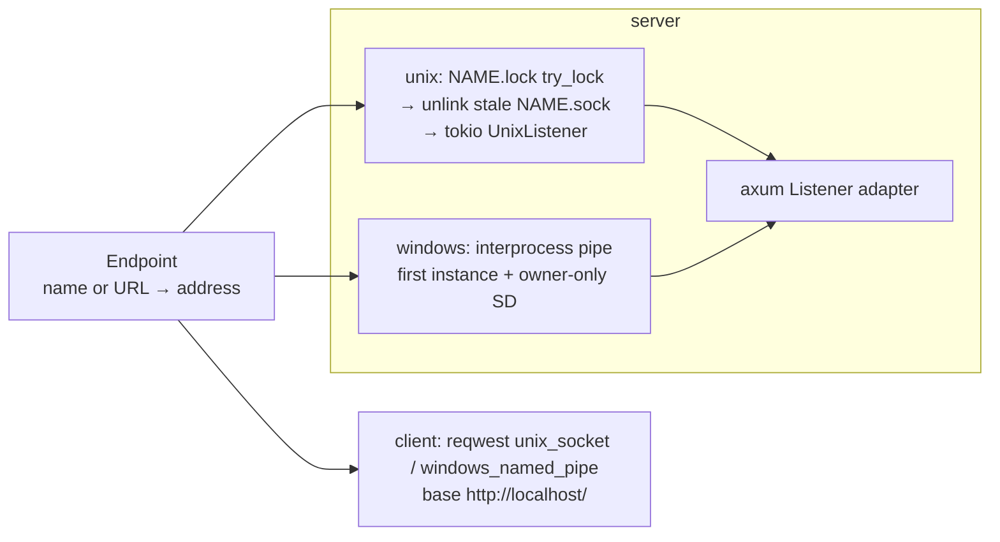
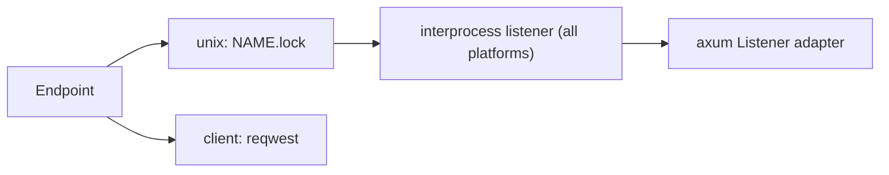
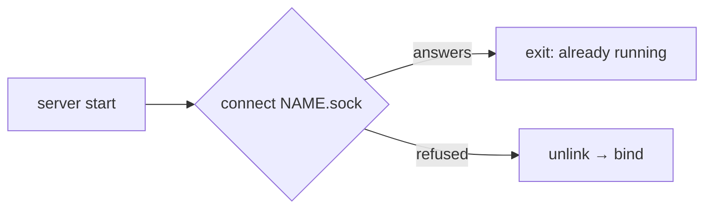
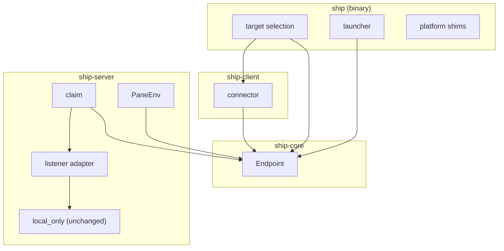

# Local socket: architecture

Status: Locked on 2026-10-27, approved by Cyan in Plannotator ("LGTM"). Built on the locked `product.md`. Shape A, with interprocess as a Windows-only dependency, was chosen in conversation before the draft. The approval doesn't authorize implementation; Cyan requests that separately.

## Summary

The server moves from a TCP listener to a Unix socket, or a named pipe on Windows. A server's name maps to one place, an `Endpoint`, which both the server and the client use. On Unix, a lock file decides who owns a name, so stale sockets and launch races are handled the same way. On Windows, the pipe itself does that job, and the interprocess crate supplies owner-only permissions and the pipe-instance handling. The client keeps reqwest and changes only how it builds its connection. Linux and macOS add no new dependencies.

Needs Cyan's attention: K-5 (interprocess as a Windows-only dependency) and R-2 (Windows remains untested by hand).

## Context and constraints

- `crates/ship-server/src/lib.rs:166` `serve(address: SocketAddr, ...)` binds a `TcpListener`, sets `TCP_NODELAY` through `tap_io`, and hands the listener to `axum::serve`. The server binds before it restores tabs, and it doesn't accept connections until the starter tab exists. That ordering stays.
- `crates/ship/src/local.rs` launches the default server. It spawns `ship server --port 43179 --starter --background-child`, then polls health for up to five seconds. A child that loses the race exits, and the launcher's final probe accepts the winner. Today, TCP's `AddrInUse` is what makes exactly one server win.
- `crates/ship-client/src/lib.rs:167` maps `io::ErrorKind::ConnectionRefused` to `ErrorCode::ConnectionRefused`. The launcher and `ship server stop` (`commands.rs:73`) treat that code as "no server". A missing socket file shows up as `NotFound`, not as refused.
- `crates/ship/src/main.rs:227` builds the reqwest client from an `http(s)` URL, trying HTTP/2 prior knowledge first and falling back to HTTP/1.1. reqwest 0.13.5 has `unix_socket()` (Unix) and `windows_named_pipe()` (Windows). Its pipe connector opens the pipe once and doesn't retry if the pipe is busy (`connect.rs:726`).
- `crates/ship-server/src/pane.rs:154` gives each pane `SHIP_SERVER_URL`, built by `PaneEnv::new(address, config)`.
- `crates/ship-server/src/middleware.rs` `local_only` refuses requests that carry `Origin` and requests whose host isn't loopback. FR-010 keeps it. The client's `http://localhost/` base satisfies it.
- Windows doesn't build today: `main.rs` `detach` and `diagnostics::shutdown` exist only for `cfg(unix)`, and `vendor/ratatui-ghostty/src/colors.rs` uses Unix file-descriptor calls ungated. With those gated, the workspace cross-checks for `x86_64-pc-windows-gnu` (checked on macOS with zig; it didn't link and no tests ran).
- Hard limits: the server listens on no TCP port (FR-001). There's a roughly 20k-line implementation budget. Own the domain and rent the mechanisms. Windows is best effort.

## Candidate shapes

### A: tokio directly on Unix, lock file; interprocess on Windows (chosen)

Unix: the server takes `NAME.lock` with `File::try_lock`. Holding the lock proves no live server owns the name, so it can unlink any leftover `NAME.sock` and bind a tokio `UnixListener`. The kernel releases the lock when the process dies, including on `kill -9`. Windows: interprocess creates the pipe with the first-instance flag, so a second server fails on its own, and an owner-only security descriptor. Its `accept()` opens the next pipe instance before handing off the connected one. On both platforms, a small adapter implements axum's `Listener`. Cost: one adapter, a lock module, and a dependency that compiles only on Windows. Failure mode: a filesystem that ignores `flock` (some network mounts) lets two servers claim one name. The runtime directories aren't on such mounts.

### B: interprocess on every platform

The same as A, except that Unix also listens through interprocess. On Unix it adds only an unlink when the listener is dropped and an `fchmod` that the `0700` directory already makes unnecessary. It still needs the lock, because its `try_overwrite` unlinks a live server's socket and nothing tells that server. It also still needs the adapter and reqwest. Cost: about 12k lines of dependency on the priority platforms for one `remove_file` call.

### C: probe and unlink, no lock (tmux)

The server connects to `NAME.sock`. If something answers, it exits. If not, it unlinks the file and binds. This has the fewest pieces, but it fails the P1 ten-launches story. Two servers both see "refused" and both unlink, then one binds over the other's fresh socket. That leaves a running server nobody can reach, which still holds its saved-tabs file.

## Decision

Shape A. What matters most is the least owned code on Linux and macOS, plus a name arbiter that can't race. B adds a large dependency to the priority platforms for one line of benefit, and C breaks a P1 story.

## Structure

| Box | Owns |
| --- | --- |
| Endpoint | The name rules (letters, digits, `-`, `_`). The per-user socket directory for each platform. Name to `unix:` or `npipe:` URL, URL to address. Checking that the directory is owned by the current user and closed to others. Unix uses `XDG_RUNTIME_DIR`, then `TMPDIR` on macOS, then `/tmp/ship-UID`. Windows uses `\\.\pipe\ship-USER-NAME`. |
| target selection | FR-007's order: `--server-url`, `--server-name`, `SHIP_SERVER_URL`, `SHIP_SERVER_NAME`, `default`. Rejecting both flags together. Rejecting `http(s)` URLs with a pointer to the socket form. Whether a target may auto-start: only a name may. |
| connector | Building the reqwest client for an address: `unix_socket` or `windows_named_pipe`, base `http://localhost/`, the same HTTP/2-then-HTTP/1.1 fallback. Treating `NotFound` on the socket path like `ConnectionRefused`. |
| launcher | Today's launch rules, now keyed by name: `--name NAME` in place of `--port`, with logs under `logs/NAME/`. Unchanged readiness polling and final probe. |
| claim | Server startup for one name. Unix: create the directory `0700`, check it, take `NAME.lock`, unlink a stale `NAME.sock`, bind. Windows: create the first pipe instance. Losing to a live server returns `Conflict` ("already running"). Holds the lock for the life of the process. Removes `NAME.sock` on a clean shutdown. |
| listener adapter | axum's `Listener` over the Unix listener or the interprocess pipe listener. Replaces `tap_io`/`TCP_NODELAY`, which has no meaning on sockets. |
| PaneEnv | `SHIP_SERVER_URL` set to the server's own `unix:` or `npipe:` URL. |
| platform shims | Windows forms of `detach` (process creation flags) and `shutdown` (Ctrl+C and close events). The `colors.rs` terminal query gated to Unix. |
| local_only | Unchanged. A second layer behind the socket's permissions. |

`ship server status` gains `socket` from the claim's address. Saved tabs move to `tabs/NAME.json`.

## Key decisions

1. **K-1: Name ownership is a lock file on Unix and the pipe on Windows.** Rejected: probe and unlink (shape C, races); binding first and treating `AddrInUse` as "running" (a stale file then blocks forever, which fails the P1 crash story); a PID file (PIDs get reused, and it needs its own cleanup). The lock is `NAME.lock` beside `NAME.sock` and is never deleted. An empty lock file left behind is harmless. Precedent: Wayland's `wayland-0.lock`.
2. **K-2: The server takes the lock before binding and holds it for its whole life.** Rejected: taking it only during bind. The lock has to outlive the bind, or a second server could take it, decide the socket is stale, and unlink a live server's socket.
3. **K-3: `Endpoint` lives in ship-core and is shared.** Rejected: computing paths separately in the client and the server, which drift apart. The client checks the directory too, so connecting by name can't reach a squatter's socket in a shared `/tmp`. An explicit `--server-url` is trusted as given, since that's how ssh forwarding works.
4. **K-4: The client stays reqwest, with its own Unix and pipe connectors.** Rejected: a hand-made hyper connector over interprocess streams. reqwest already does both, and its connection pooling and HTTP/2 path stay the same.
5. **K-5: interprocess is a Windows-only dependency.** It gives owner-only permissions from a descriptor string, and its `accept()` opens the next pipe instance before handing off the current one, which reqwest's no-retry connector needs. Rejected: tokio's `NamedPipeServer` by hand (about 30 lines of `unsafe` security-attribute setup and instance rotation in Ship); Windows' default pipe permissions (other users get read access, which doesn't meet FR-002's "only the current user"); interprocess on all platforms (shape B).
6. **K-6: HTTP and the `local_only` middleware stay as they are.** Rejected: dropping the Host and Origin checks now that only the user can connect. They cost nothing and still refuse a proxy placed in front of the socket.
7. **K-7: Windows ships as a CI job that is allowed to fail.** The `continue-on-error` matrix entry. Rejected: a blocking job, since Windows is best effort.

## Risks and unknowns

- **R-1: Latency over Unix sockets.** Expected to match or beat loopback TCP, which also loses Nagle's algorithm as a factor. SC-003 measures this on macOS before and after. Linux is unverified unless measured.
- **R-2: Windows is untested by hand.** Nothing here has run on Windows: pipe permissions, the `OW` (owner rights) descriptor, detaching, the Ctrl+C shutdown path. CI shows build and test results only. If the `OW` descriptor doesn't work as read, the fallback is the user's SID in the descriptor string, which interprocess still accepts.
- **R-3: `$TMPDIR` on macOS can be cleaned.** macOS periodically deletes old files from per-user temp directories. If that cleanup counts a long-running server's socket file as old, the server stays running but nobody can reach it by name. I haven't checked which rules the cleanup uses. If it happens, the server could touch the file periodically, or the macOS location could move to `~/Library/Caches`.
- **R-4: Unix socket path length.** `sun_path` is 104 bytes on macOS and 108 on Linux. A long `$TMPDIR` plus `ship/NAME.sock` fits. A long name might not. The name check bounds the length.
- **R-5: Rollback.** It's a single revert. Old clients can't reach new servers, and the reverse fails too, but Ship has one user and one binary.
- **R-6: Ten times the servers or connections.** Each name has one socket and one lock, and the directory listing is the inventory. Nothing here grows worse than TCP.
