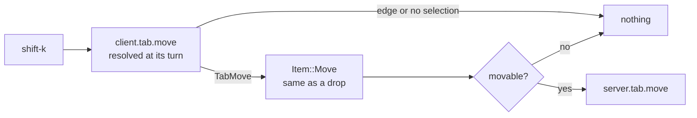
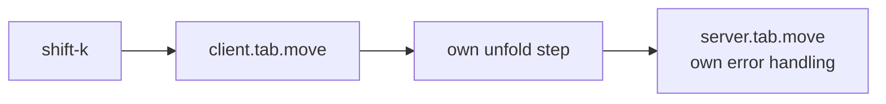
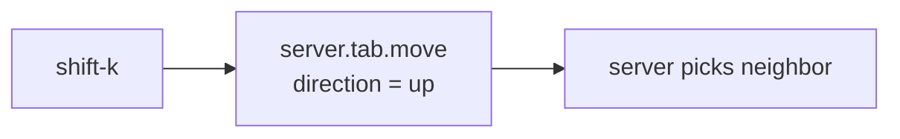
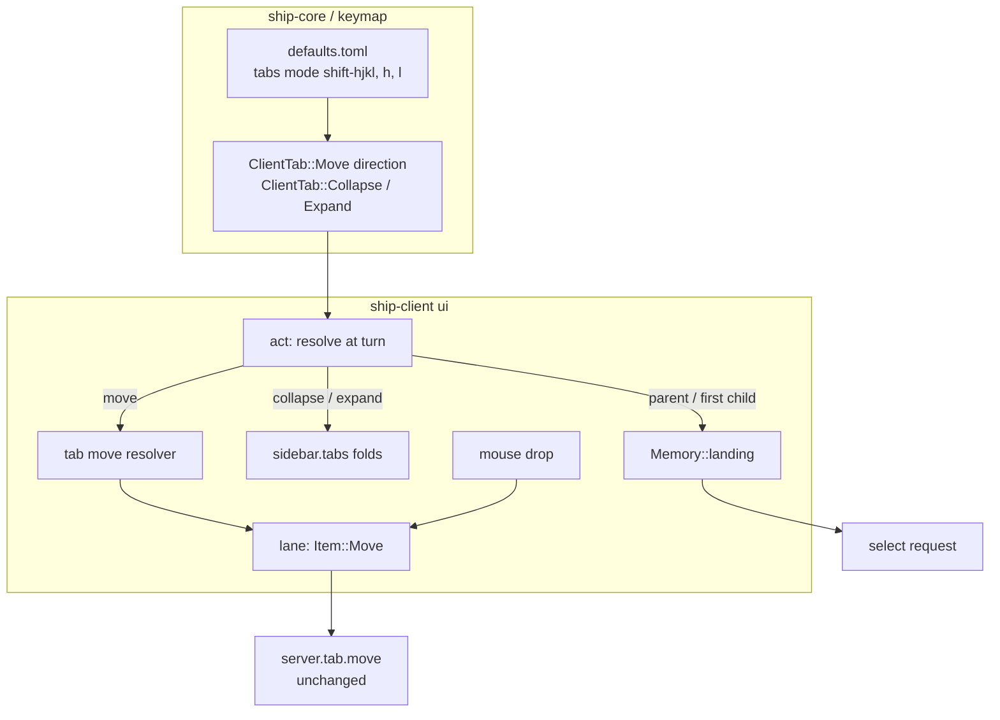

# Keyboard tab work in tabs mode: architecture

Status: Locked on 2026-10-27. Built on the locked `product.md`. Cyan picked shape A in chat ("A semes much cleaner. go for it!"), with the deciding outcome that a keyboard move and the same mouse drop can never behave differently, then approved in Plannotator review ("LGTM").

## Context and constraints

- **Mouse drops already do the hard part.** A drop queues `Item::Move(TabMove { tab, to })` in the client's lane (`ui/lane.rs:32`). At its turn, `ui/mod.rs:636` re-checks it with `movable` (`ui/sidebar/tabs.rs:339`), unfolds the parent for a `MoveTab::Parent(Some(_))` target, sends `move_tab`, and swallows `not_found` and `invalid_structure`. That covers FR-008 (resolve at its turn), FR-009 (unfold, staying unfolded on failure) and the silent-failure half of FR-006.
- **The lane resolves against a fresh tree.** `Lane::next` hands out an item only after the observer has caught up with the client's own writes, so the second `shift-k` sees the tree the first one produced.
- **Client actions already hand off to lane items.** `client.pane.swap` resolves its neighbor in `act` and returns `Turn::First` with the server command it built (`ui/mod.rs:780`). `client.tab.next`/`prev` resolve with `navigate` and land through `Memory::landing`.
- **Folding is client state.** `sidebar.tabs` holds the `collapsed` set, `fold` sets it, and `reconcile` forgets folds on tabs without children. The fold handler for `client.tab.collapse`/`expand` sits in `act` (`ui/mod.rs:813`).
- **Tree helpers are in `ship-core/src/tree.rs`.** These are `path`, `siblings` and `viewed_tab`. A tab's children are its `tabs` field, an ordered map.
- **`server.` actions can't read shared state to decide what to send** (entity-shapes FR-013, now in the keymap spec). Sibling order is shared state, so a relative move has to be a `client.` action.
- **Moves are one-destination.** `MoveTab` is `Parent(Option<tab>)`, `Before(tab)` or `After(tab)`. `Parent(Some(p))` appends as p's last child.

## Candidate shapes

### A. The client resolves the direction, then queues the drop's existing request (winner)

`client.tab.move` resolves its direction in `act`, at its turn, from the client's copy of the tree and the selection. It turns the direction into a `TabMove` and returns it as `Turn::First(vec![Item::Move(..)])`. From then on it's indistinguishable from a drop: same re-check, same unfold, same quiet failure. The cost is a small resolver and an enum variant. If it fails, the failure is shared with drops, so fixing one fixes both. Rolling back means dropping the variant and the four default bindings.

### B. The client resolves the direction and sends `server.tab.move` directly

This is the same resolver, but `act` returns `Action::Server(Command::Tab(Move ..))`, as swap does. It has to copy the unfold step and map errors itself, so it can drift from drops. That breaks SC-004 as soon as one path changes.

### C. The server takes a direction

This would add `direction` to `server.tab.move` and let the server pick the neighbor. It would be atomic, and the CLI would get it too. But it reads shared state to decide what to do, which entity-shapes FR-013 forbids for a `server.` action. It also changes the protocol, which the product paper's non-goals exclude.

## Decision

Shape A. What matters most is that a keyboard move and the same mouse drop can never behave differently (SC-004). Only A puts both through one request type, so B and C each need a second copy of the move rules.

## Structure

- **`defaults.toml`** owns the default bindings and their labels (FR-011).
- **`ClientTab`** (`keymap.rs`) owns the action names: the new `Move { direction }` with `up`, `down`, `in`, `out`, and the existing `Collapse`/`Expand`.
- **The tab move resolver** owns FR-005 to FR-007. It takes the tree and the selection and returns a `TabMove` or nothing. It reads siblings from the tree, never from visible rows.
- **`act`** owns turn timing for both features. It calls the resolver, and it decides between folding and selecting for `h`/`l`.
- **`sidebar.tabs` folds** keep owning fold state. `h`/`l` only read it to decide whether to fold or select.
- **`Memory::landing`** keeps owning where a selected tab lands (FR-001, FR-002).
- **`Item::Move`** keeps owning the turn-time check, the unfold and quiet failure, now for both drops and keys.
- **The server** doesn't change.

## Key decisions

- **KD-1. Resolve in `act` and hand off to `Item::Move`.** Rejected: sending the server command directly (B), and a server-side direction (C). Both are covered under Candidate shapes.
- **KD-2. Map each direction to one `MoveTab`.**
  - `up` → `Before(previous sibling)`
  - `down` → `After(next sibling)`
  - `in` → `Parent(Some(previous sibling))`
  - `out` → `After(parent)`

  Rejected: `down` as `Before(the sibling after next)`, because the last-but-one position would need a special case. Also rejected: `out` as `Parent(grandparent)`, which appends at the end of the grandparent's children instead of right after the parent.
- **KD-3. Report edges by returning nothing from the resolver, and send no request.** Rejected: sending the move and letting `movable` or the server refuse it. The product paper requires no request at an edge (FR-006), and returning nothing keeps an edge distinct from a stale target.
- **KD-4. Change the `Collapse`/`Expand` handler rather than add actions.** The product paper settled this (FR-001 to FR-003). Selecting the parent or first child goes through the same select request and `Memory::landing` as `j`/`k`, so landing and revealing ancestors behave the same.
- **KD-5. Siblings come from the tree, not from visible rows.** This is FR-007. Rejected: reusing `sidebar.tabs.visible`. Visible rows mix in the children of unfolded tabs, so the row above isn't always the previous sibling.

## Risks and unknowns

- **The `movable` re-check may refuse a valid keyboard move.** `movable` was written for drag targets. For example, it rejects `Parent(p)` when the tab is already p's last child. None of KD-2's targets should hit that case, since `in` targets the previous sibling, never the current parent. The program paper should still check each direction against `movable` at a sibling-list edge.
- **Lane latency on repeated presses.** Each press waits for the server to publish the previous move. Drops already work this way and feel fine. If holding `shift-k` feels slow in real use, that's a lane question shared with drops, not a reason to resolve ahead of the tree.
- **The spec line FR-003 replaces.** `session-observation/spec.md:147` says folding never changes the selected tab to a child. The delta spec has to rewrite it. Otherwise the synced spec contradicts `l`.
