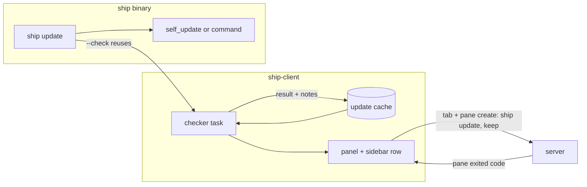
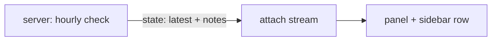
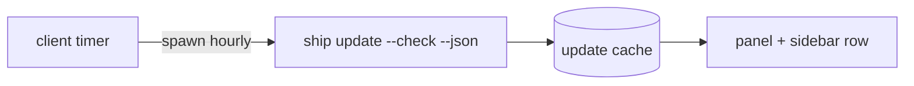
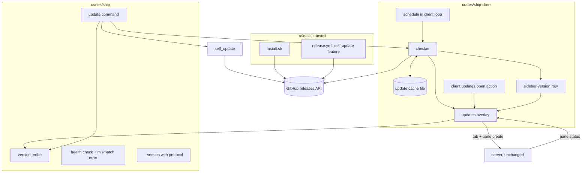

# Architecture: update notices, an updates panel and `ship update`

Status: Locked on 2026-11-02. Built on the locked [product.md](product.md). Shape A was chosen in chat ("A sounds good to me"), then the paper was approved in Plannotator review ("LGTM"). The risks below that point at open product unknowns stay open until Cyan decides them.

## Approved amendment: the version probe

Drafting `program.md` found two problems with the probe as drawn. Under the ripple rule this re-opened the probe box and KD-6 only. Cyan approved it with `program.md` in Plannotator review ("LGTM") on 2026-11-03; the rest stays as locked. The Structure section's probe box and KD-6 below are superseded where they say `crates/ship` or "before swapping".

- **It moves from `crates/ship` to `ship-client`.** The updates overlay needs it after its update pane exits, and the client library can't depend on the binary crate. The binary calls it from there, as it does the checker.
- **It runs after the swap, not before.** `self_update`'s ordinary update path downloads, verifies and replaces in one call. Probing the downloaded binary first would mean taking that path apart into its download, extract and replace pieces. FR-017 only asks Ship to say afterwards whether the server must restart, so the probe reads the installed binary (`current_exe()` after self-replace, `ship` on `PATH` after a command).

The product amendment also settles the risks for OU-1, OU-2, OU-4 and notes from `latest_command`. The hidden-sidebar notice is the one-shot status message, OU-2 is the probe on `PATH`, OU-4 is a build-time repository override read by both the checker and `self_update`, and notes always come from GitHub by tag.

## Context and constraints

The repo already has most of the pieces:

- **Overlays.** The full-screen client's loop in `crates/ship-client/src/ui/mod.rs` holds one `Overlay` (`Menu` or `Rename`) that takes input before the mode machine. The panel becomes a third overlay.
- **Background results.** The same loop already takes results from channels in its `tokio::select!` (finished runs arrive on `local.ended`). A check result can arrive the same way without blocking input.
- **Server version.** `/health` returns `version` and `protocol_version` (`HealthResponse` in `crates/ship-core/src/protocol.rs`). The binary calls it before the client starts, in `health()` in `crates/ship/src/main.rs`, which also produces today's mismatch error.
- **Running a command in a tab.** `tab create` plus `pane create` with argv and `exit_behavior = "keep"` already exist. The default pane menu's `edit scrollback` item runs `"$SHIP_BIN" pane edit-scrollback` the same way. A pane's published `status` becomes `exited { code }` when its program ends, so the client can follow a run with no new message.
- **HTTP.** reqwest 0.13 with rustls is a workspace dependency already used by `ship` and `ship-client`.
- **State directory.** `runlog::state_dir()` in `crates/ship/src/runlog.rs` gives the XDG state directory on Linux and macOS.
- **Config.** Client settings parse with `deny_unknown_fields` over `crates/ship-core/src/defaults.toml`, so `[client.updates]` needs a defaults entry and a field.
- **Releases.** `release.yml` builds each target with `taiki-e/upload-rust-binary-action`, which uploads a `.tar.gz` and its `.sha256` per target. release-plz creates the GitHub release with that version's changelog as the body.

Hard limits from `AGENTS.md`: no live handles across the client/server boundary, rent mechanisms (`self_update`, `tui-markdown`) rather than writing them, keep implementation Rust well inside the 20,000-line budget, and validate on Linux and macOS.

## Candidate shapes

### A. The client checks, in-process (winner)

A small `updates` module in `ship-client` owns checking. It asks GitHub with one reqwest GET, or runs `latest_command`, and writes the result and the notes to a cache file in the state directory. That file is also the one-hour stamp other clients read. The panel and the sidebar row render from the result. `ship update` lives in the binary crate with `self_update`, and `--check` calls the same checker. The server and the protocol don't change. Cost: one client module, one overlay, one subcommand. Failure mode: a torn or stale cache file, handled by treating any unreadable file as no cache.

### B. The server checks and publishes (rejected)

The server checks hourly and publishes the latest version and notes in its state. One check per machine comes free and remote servers would be ready. It costs a protocol bump, puts network access in the server, and after an update the server is still the old binary, so it judges "latest" against the wrong version. The product paper already has the client do the checking.

### C. The binary checks, and the client spawns it (rejected)

All network code and `self_update` stay in the binary crate. The client spawns `ship update --check --json` hourly and reads the cache. That adds a JSON contract between two processes of the same binary and an hourly spawn, all to keep one reqwest call out of a crate that already uses reqwest. A already shares a single code path because the binary calls the client's checker.

## Decision

A. What matters most is that the server and protocol stay untouched. An update feature that needs a protocol bump would force the very restart it's trying to explain, and A gets everything the product paper asks for with code only in the client and the binary.

## Structure

What each box owns:

- **checker** (`ship-client`): finding the latest release and its notes. Source order: `[client.updates] latest_command`, `SHIP_LATEST_COMMAND` from build time, then GitHub's releases list, skipping drafts and prereleases. Reads the cache first and asks only when the cache is over an hour old or the caller forces it (`[check]`, `ship update --check`). Never shows errors; it returns them to the caller.
- **update cache file** (state directory): the last check's time, latest version and the notes for each release, written whole by temp file and rename. It's the one-hour stamp shared by every client on the machine. A missing or unreadable file means "no cache".
- **schedule** (client loop): runs the checker at startup and hourly when `check = true`, off the input path, and delivers the result on a channel like `local.ended`. Only the full-screen client has one; CLI commands never do.
- **updates overlay** (client): the panel. Renders versions, state and notes (markdown through `tui-markdown`). `[check]` forces the checker. `[update]` opens a tab named `update` with one pane running `"$SHIP_BIN" update` and `exit_behavior = "keep"`, remembers that pane, and reads its published status to show updating, installed or failed. If the pane is closed before it exits, the panel goes back to "available".
- **sidebar version row** (client): the bottom row, showing the client's version dimmed, or `installed → latest` in the accent color. Clicking it opens the overlay. The hidden-sidebar notice waits on product OU-1; the existing one-shot status message is the mechanism either way.
- **client.updates.open action** (keymap): opens the overlay. The default global menu gets an `updates` item bound to it. No default key.
- **update command** (`crates/ship`): `ship update` and `ship update --check`. Picks the method: config `command`, `SHIP_UPDATE_COMMAND`, `self_update` when built with the `self-update` feature, else none with an error. Prints the sync message afterwards.
- **version probe** (`crates/ship`): runs a `ship` binary with `--version` and reads its release and protocol versions, then compares them to the server's `/health`. Used before swapping in a downloaded binary and after a command method (OU-2), and by the overlay after its update pane exits.
- **health check + mismatch error** (`crates/ship`): today's `health()`, with the error rewritten to name both versions and protocols and the restart command.
- **--version with protocol** (`crates/ship`): clap's version string gains the protocol, which the probe parses.
- **release.yml**: builds release targets with the `self-update` feature, keeps uploading `.tar.gz` and `.sha256`, and gains the Intel macOS row if it cross-compiles (product OU-3).
- **install.sh** (repo root): first installs. Detects OS and architecture, downloads the matching archive and `.sha256` from the latest release, verifies, installs to `~/.local/bin`, and prints a PATH hint.

## Key decisions

1. **The client checks, in-process (shape A).** Rejected: the server checking and publishing (B), which needs a protocol bump and judges against the old binary; the client spawning the binary (C), which adds a cross-process JSON contract for nothing.
2. **The cache file is also the stamp.** One file holds the time and the result, so a client that skips its check still has something to show. Rejected: a bare timestamp file, since a second client would know a check happened but not what it found; per-client memory only, since that sends one request per client.
3. **The client asks GitHub with its own reqwest call; `self_update` stays in the binary.** The check needs one GET and a few fields per release. Rejected: `self_update`'s release listing in the client, which would compile its download and replace machinery into the client library to read four fields.
4. **`self_update` sits behind a `self-update` cargo feature that only `release.yml` enables.** A source or packaged build doesn't compile the dependency, and a feature that's off can't replace anything. Rejected: an `option_env!("SHIP_SELF_UPDATE")` build flag, which still compiles the code into every build and is easier to set by accident.
5. **The update runs in a real pane, through existing requests.** Tab create plus pane create with `"$SHIP_BIN" update` and `exit_behavior = "keep"`, followed through the pane's published status. Rejected: streaming output inside the panel (a log view to build), and running it locally through the client's `Runner` (output goes to a log file, not a pane, and it would run on the client's machine instead of the server's).
6. **"Restart needed?" comes from asking the binary.** The probe runs `--version`, which now includes the protocol, and compares it with `/health`. Rejected: guessing from semver (release-plz doesn't tie protocol bumps to breaking releases), and publishing the protocol with each release (out of scope in the product paper).
7. **Release notes render through `tui-markdown` with default features off.** It adds `pulldown-cmark` and a second `itertools`, and reuses Ship's `ratatui-core`. Rejected: stripping markdown by hand (owned code for a solved problem), and `termimad`/`ratskin` or `ratatui-markdown`, which bring a layout engine or scroll widgets and syntax highlighting.

## Risks and unknowns

- **Product OU-1 and OU-2 are still open.** OU-1 (the notice when the sidebar is hidden) touches only the sidebar row and the status message. OU-2 (restart guidance after a command) is covered by the probe either way. Neither changes this shape, but both block their pieces of the program.
- **Notes when `latest_command` is the source.** A packager's command returns a version, not notes, so the panel would have versions and no notes there. FR-010 requires notes. Options: still fetch notes from GitHub for that version, or show only a link. This needs a product amendment before the panel's notes are built.
- **`self_update`'s checksum naming.** Whether its checksum check reads the `.sha256` files that `upload-rust-binary-action` writes as they are hasn't been verified against a real release. If not, the update command verifies them itself before handing over the archive.
- **Testing before a second release exists** (product OU-4). A build-time override for the release repository, or opting into prereleases, is the likely seam. It must not change what real users see.
- **Concurrent writers.** Two clients can check at once near the hour mark. Writing by rename keeps the file whole; the worst case is two requests instead of one, which SC-003 tolerates only rarely. A lock file is the fallback if it shows up in practice.
- **Shared IPs.** GitHub's unauthenticated limit is 60 requests an hour per IP. Hourly checks per machine stay far below it, but many machines behind one NAT could hit it. Failures are silent and retried, so the cost is a late notice.
- **`$SHIP_BIN` after a swap.** On Unix, replacing the file under a running process is safe. Whether the old client's view of its own path still points at the new file on macOS needs checking during the build; the probe depends on it.
- **Intel macOS cross-compile** (product OU-3) is unknown until tried.
- **Windows.** `self_replace` handles Windows, but there are no Windows release builds, so the path is untested there. Best effort.
