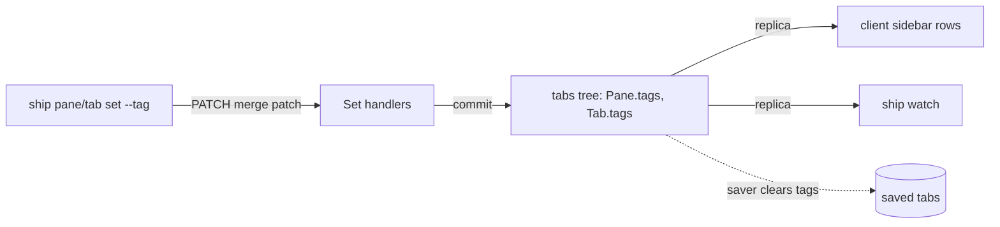
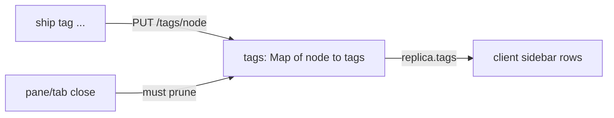
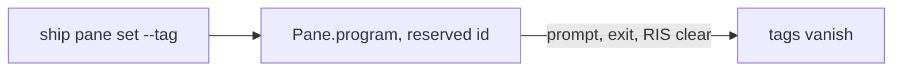
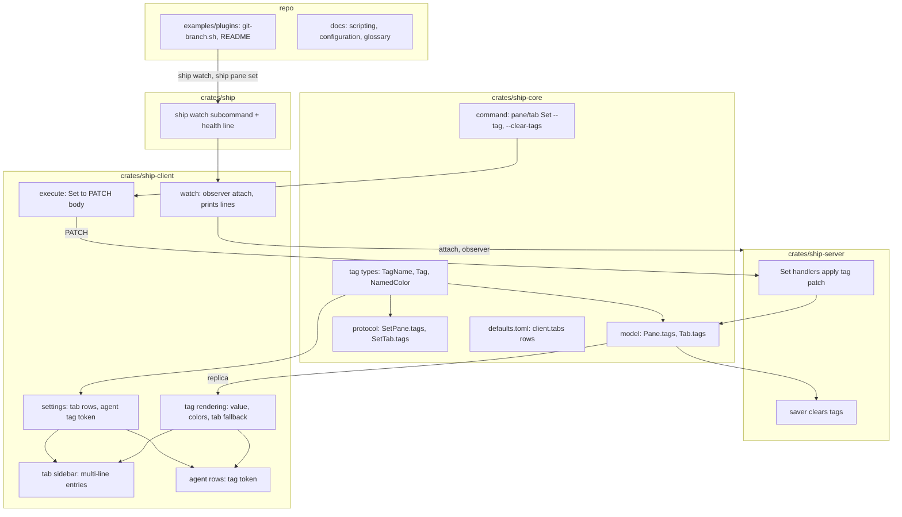

# Architecture: `ship watch` and tags

Status: Locked on 2026-11-04, re-approved after the rename from labels to tags ("If you renamed everything properly, then they're good to go"). First locked on 2026-11-04. Built on the locked [product.md](product.md). Shape A was chosen in chat on 2026-11-04 ("i think i agree with A too!"), then the paper was approved in Plannotator review ("LGTM"). Risks that point at open product unknowns stay open until Cyan decides them.

## Context and constraints

The repo already has most of the pieces:

- **Observer attach.** `ship pane wait` attaches with no selection and no area (`observe()` in `crates/ship-client/src/automation.rs`), so it moves and sizes nothing and gets no screens or clipboard. The stream delivers `Attached { attachment, replica }`, then `State(replica)` per revision, and ends with `Ended { reason }`, where the reason is `server_shutdown` or `lost` (`crates/ship-core/src/protocol.rs`). `AttachRequest.feed` already takes `latest` or `every`.
- **Protocol version.** Every CLI command runs the health exchange first (`health()` in `crates/ship/src/main.rs`), and `HealthResponse` carries `protocol_version`.
- **Setting attributes.** `pane::Set` and `tab::Set` in `crates/ship-core/src/command.rs` are the CLI and config forms. The client turns them into `SetPane` and `SetTab` bodies for `PATCH`, where an absent field is unchanged and `name: null` clears. The server's `Set<Pane, SetPane>` and `Set<Tab, SetTab>` handlers in `crates/ship-server/src/state.rs` build the new value and commit only when it differs, so a write that changes nothing publishes nothing.
- **Not saving.** The saver blanks per-run fields before writing (`crates/ship-server/src/saver.rs`): `title`, `command` and `program` are cleared there.
- **Fallback names.** `tab_label` and `tab_auto_label` in `crates/ship-client/src/ui/draw.rs` give a tab without a name its first pane's directory or label, computed when drawing. `ship tab get` keeps `name` empty.
- **Agent rows.** `[client.agents] rows` parses into `Vec<Vec<Token>>` (`crates/ship-client/src/keymap.rs`), where `Token` is a serde enum of unit variants (`icon`, `app`, ...). `row()` in `crates/ship-client/src/ui/sidebar/agents.rs` drops tokens without a value and lines left empty.
- **Tab rows.** `crates/ship-client/src/ui/sidebar/tabs.rs` assumes one row per tab: `walk()` emits one `Row` per tab, and scrolling, hit-testing and drag gaps index into that list by screen line. The selected tab draws with a dark-gray band.
- **Config.** Settings parse with `deny_unknown_fields` over `crates/ship-core/src/defaults.toml`. `server.pane.set` is also used from menus and keys, for example `right_click_passthrough = "toggle"`.

Hard limits from `AGENTS.md`: the client reaches the server only through commands, responses and events; shared state is server-authoritative and clients render what the server publishes; rent mechanisms rather than writing them; keep implementation Rust well inside the 20,000-line budget; validate on Linux and macOS.

## Candidate shapes

### A. Tags are attributes on `Pane` and `Tab` (winner)

`tags` sits beside `program` on `Pane` and beside `zoomed` on `Tab`. `SetPane` and `SetTab` gain a merge-patch `tags` field, and the existing `Set` handlers apply it with the rest of the patch, keeping their commit-only-on-change rule. The saver clears tags with `program`. Clients read them from the replica they already receive. `ship watch` is a CLI command over the observer attach, and the sidebar learns tag tokens. Cost: one field on two model structs and two patch bodies, one CLI command, one token kind and a multi-line tab row. Failure mode: a tag written to a pane that closes in the same moment fails with the existing not-found error.

### B. A tag table beside the tree (rejected)

Tags live in their own map in the replica, keyed by tab or pane, like `viewers`, with their own endpoint and command. The tree stays untouched and an owner column would be easy later. But it contradicts the product's `set` flags, `ship pane get` needs a join to show tags, and every close path must prune the table or tags outlive their node.

### C. Tags as program-status records (rejected)

Tags ride in `Pane.program` under a reserved id and reuse the record plumbing. Status-record lifetimes would wipe them on every prompt, exit and terminal reset, and tabs have no records.

## Decision

A. What matters most is that tags are plain attributes, set and published like a name. A reuses the patch, commit and publish path that names already take, so the server change is a field and a few lines in two handlers. B's only advantage, room for ownership, isn't needed until ownership is designed, and A can take an owner field then.

## Structure

What each box owns:

- **tag types** (`ship-core`): `TagName`, which parses and validates (non-empty, no `=`, no control characters) so an invalid name can't be represented; `Tag`, a value with optional `fg` and `bg`; `NamedColor`, the 16 terminal colors as a serde enum. Core stays free of ratatui.
- **model** (`ship-core`): `tags` on `Pane` and `Tab`, insertion-ordered like `program`, omitted when empty.
- **protocol** (`ship-core`): the merge-patch `tags` field on `SetPane` and `SetTab`: absent leaves all, a map patches per name with `null` removing one, and `tags: null` removes all.
- **command** (`ship-core`): repeatable `--tag NAME=VALUE`, bare `--tag NAME` and `--clear-tags` on `pane set` and `tab set`. CLI only; menus and keys don't take tags (KD-6). Color flags wait on OU-1.
- **Set handlers** (`ship-server`): apply the tag patch with the other fields and keep committing only on change, so FR-011's single state and no-op rule hold.
- **saver** (`ship-server`): clears tags before writing, beside `program`.
- **execute** (`ship-client`): folds the repeated flags into the patch map, last occurrence winning.
- **watch** (`ship-client`): the observer attach with the requested feed, printing each `Attached` and `State` replica as one JSON line, skipping screen and clipboard events, and handling the end per OU-3.
- **ship watch subcommand** (`crates/ship`): the CLI entry; prints the health exchange's `protocol_version` as the first line, then hands over to watch.
- **settings** (`ship-client`): parses `[client.tabs] rows` into tab tokens (`name` or `{ tag = "..." }`) and gives agents' `Token` a `Tag` variant.
- **tag rendering** (`ship-client`): looks a tag up (on a tab, its own value, else its first pane's, as `tab_auto_label` does for names) and draws its value with its colors, leaving separators unstyled.
- **tab sidebar** (`ship-client`): draws each tab's entry as several lines (KD-5), keeping fold markers, the selection band and rollup icons on the first line.
- **agent rows** (`ship-client`): the existing `row()` gains the tag token, reading the agent's pane.
- **examples/plugins**: `git-branch.sh` runs `ship watch`, tags each pane with its directory's branch, and clears it outside a checkout; the README says how to run it and which rows show it.
- **docs**: `docs/site/scripting/` covers `watch` and tags with the conventions from FR-020; `docs/site/configuration.md` covers rows; `GLOSSARY.md` gains **Tag**.

## Key decisions

1. **Tags are attributes on `Pane` and `Tab` (shape A).** Rejected: a separate tag table (B), which needs joins and pruning; reusing status records (C), whose lifetimes are wrong and which tabs lack.
2. **`watch` is client-side only.** It reuses the observer attach and prints what arrives. Rejected: a new server endpoint streaming JSON lines, which duplicates the SSE stream for no new capability.
3. **The first line comes from the health exchange.** Every CLI command already fetches `HealthResponse`, so `watch` prints `{"protocol_version": N}` from it before attaching. Rejected: adding the version to `Attached`, which changes the protocol to carry what the client already knows.
4. **Row grammar uses serde's default enum format.** Unit variants read as bare strings and a newtype variant reads as `{ tag = "..." }`, so `TabToken { Name, Tag(TagName) }` and agents' `Token::Tag` need no hand-written parser. Rejected: a `$name` sigil (needs escaping and can collide), and Herdr-style token tables with style rules (out of scope).
5. **Multi-line tab entries are one `Row` per line.** Continuation lines carry their tab's ID, so a click on any line selects the tab, scrolling stays line-based, and drop gaps fall only between entries. Rejected: one `Row` with a height, which rewrites every index-by-line computation in `tabs.rs`.
6. **Tags are CLI and HTTP only, not menus or keys.** `pane::Set` is also read from config, where TOML has no `null`, so clearing one tag has no clean form there; the field is skipped in config. Rejected: a config map form that can set but never clear.
7. **The tab fallback is computed when drawing.** Like `tab_auto_label`, the client looks at the tab's own tags, then its first pane's. `ship tab get` and `watch` show only the tab's own. Rejected: the server filling tab tags from panes, which would publish derived state and break "the last write wins" for tab tags.
8. **The protocol version bumps.** `Pane`, `Tab`, `SetPane` and `SetTab` change shape, so mismatched clients and servers get the existing restart guidance.

## Risks and unknowns

- **Product OU-1 (colors on the CLI).** The shape doesn't change: whatever the flags are, they fill `Tag.fg` and `Tag.bg` in the same patch. Blocks the color flags in the command box only.
- **Product OU-2 (control characters in values).** Where the check runs is settled (the server, with the other patch validation, so HTTP clients get it too); what it rejects or strips is the open part.
- **Product OU-3 (how `watch` ends).** The stream's `Ended` reason is already there to print; the exit code and output form are the open part.
- **The tab sidebar is the largest piece.** One-row-per-tab assumptions sit in `walk()`, `row_at()`, `gap()` and the scroll offset. KD-5 keeps them line-based, but drag-and-drop between entries is the most likely place for bugs, and it needs checking by hand.
- **Watcher cost.** Each watcher costs one replica serialization per revision. SC-003 measures five; if it fails, the fix is sharing one serialized replica across watchers, which changes the server's stream code and needs its own look.
- **Agent rows' `tab` shortening.** `row()` shortens the `tab` token to fit; a tag on the same line takes room first. Long tags may squeeze the tab path to an ellipsis. Acceptable, but worth looking at with real tags.
- **Selection band and `bg`.** The band is applied after the row text today. Drawing a tag's `bg` has to happen after the band or be exempt from it, or the chip disappears on the selected row.
- **macOS.** Nothing here is platform-specific, but the git example runs `git` and reads `dir`, which on macOS comes from OSC 7 or the process's working directory. Validate on both.
