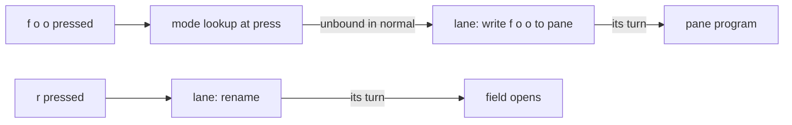
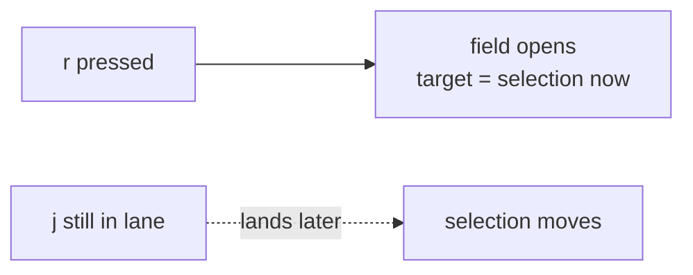
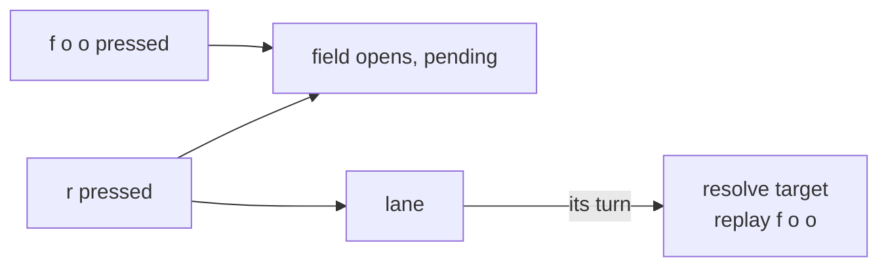
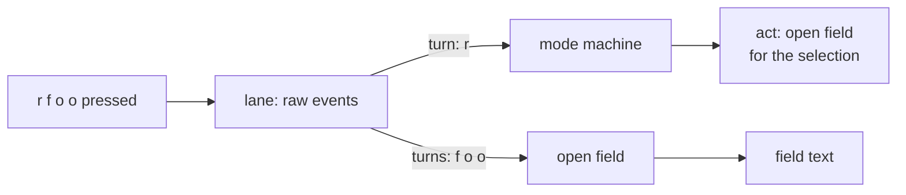
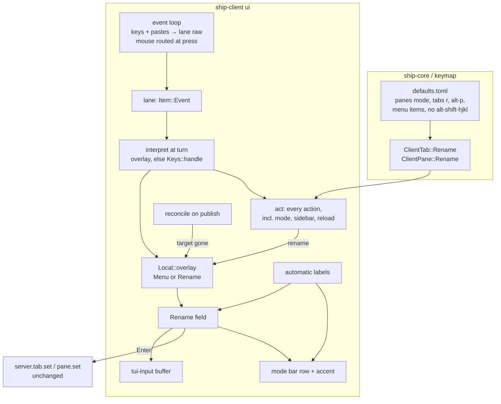

# Rename tabs and panes from the UI, and a panes mode: architecture

Status: Locked on 2026-10-30. Built on the locked `product.md`. Cyan first picked shape C in chat ("sounds good. go for it!"), then, once it was clear the queue interprets keys at press, asked for the queue to interpret input at its turn instead ("perfect! let's update it to work this way then!"). Shape D below replaces C, and was approved in Plannotator review ("LGTM"). Re-opened the same day during program design to narrow KD-5: only clicks close an overlay that opened before their turn, and other queued mouse input is dropped ("alright then let's try that then"), and approved again in Plannotator review ("LGTM").

## Summary

Renaming needs a field that takes every key while it's open. The trouble is when it opens. A rename key waits its turn in the client's input order, but today each key after it is interpreted as soon as it's pressed: looked up in the active mode and queued as a binding or as a write to the pane's program. So when the lane is behind, the keys typed after `r` are already sorted before the field exists, and `alt-p r foo` can type `foo` into the shell.

This paper moves interpretation to the turn. The lane holds the raw key or paste, and the mode machine reads it only when everything before it has taken effect. The field then opens at its turn like any other client action and needs no pending state. The same change removes the press-time exceptions for mode changes, sidebar actions and config reloads, so the client has one input rule instead of a rule with exceptions.

Needs attention: on a stalled lane, a mode switch, sidebar toggle or reload now shows only when its turn comes (KD-3), and the change rewrites requirements in the synced `keymap`, `terminal-client` and `context-menus` specs (Risks).

## Context and constraints

- **Keys are interpreted at press.** `Keys::handle` looks each key up in the active mode as it arrives and returns `Handled::Queue(Item::Action(..))` for a binding, `Handled::Queue(Item::Key(..))` for an unbound key in normal mode, or `Handled::None` for an unbound key elsewhere (`ui/keys.rs:47`). Only the target is resolved at the turn. A key's meaning comes from the mode and overlay at press, which can be several turns ahead of the input still waiting.
- **Some actions apply at press.** `keys::handled` returns `Handled::Now` for `client.mode`, `client.sidebar.*` and `client.config.reload` (`ui/keys.rs:20`), and the event loop runs them ahead of the lane (`ui/mod.rs:438`). The keymap spec requires this (`keymap/spec.md:180`, `:344`), and `context-menus/spec.md:154` repeats it for menu items. They apply at press because the mode has to be current for the next key to be interpreted at press.
- **The lane runs one item at a time, after the server has caught up.** `Lane::next` pops an item only when connected, with no request running and the observer caught up with what this client wrote (`ui/lane.rs:88`). `Turn::First` pushes follow-up items to the front (`ui/lane.rs:78`).
- **Ordered input is already the rule.** `terminal-client/spec.md:251` requires bound actions, keys, pastes and mouse input to take effect in the order they happened, with anything selection-dependent resolved after everything before it.
- **Mouse routing happens at press, against what's on screen.** `Mouse::route` hit-tests the drawn scene and returns `Clicked::*`, which the event loop turns into lane items (`ui/mod.rs:367-400`). Clicks keep the target hit at press (`Item::Select`). A press on a pane while the lane is busy selects it instead of sending it to the program (`ui/mouse.rs:307`). Mouse routing is skipped while the menu is open (`ui/mod.rs:367`).
- **The menu is the existing focus mechanism.** `Local::menu: Option<Menu>` opens at press on a right-click and, while open, takes every terminal event before the mode machine (`ui/mod.rs:405-420`). It's drawn last, over everything (`ui/draw.rs:116`). A terminal resize, a config reload and a cut connection close it (`ui/mod.rs:364`, `:590`, `:712`).
- **A dropped connection abandons waiting input.** `lane.clear()` runs on a cut (`ui/mod.rs:466`). While disconnected, only detach is acted on (`ui/mod.rs:430`).
- **The mode bar is a client overlay.** `status_line` draws over the bottom of the pane area only when there's something to say (`ui/draw.rs:99-115`). It never changes pane geometry.
- **Labels come from two functions.** `pane_label` is name, else program title, else command file name; `tab_label` is name, else first pane's directory, else that pane's label, else position (`ui/draw.rs:207`, `:220`). The sidebar row (`ui/sidebar/tabs.rs:333`) and the pane title row (`ui/panes.rs:126`) draw them.
- **Renames already exist on the server.** `server.tab.set` and `server.pane.set` take `name: Option<Option<String>>`; `Some(None)` clears (`ship-core/src/command.rs:210`, `:379`).
- **Line editing is a solved mechanism.** `tui-input` 0.15 maps crossterm key events to buffer edits (Backspace, Delete, arrows, Home/End, `ctrl-a/e/u/w/k`, word moves) from one `handle_event` call. It depends on crossterm 0.29 and ratatui 0.30.2, the versions Ship uses, and with `default-features = false, features = ["crossterm"]` adds only `unicode-width` and `unicode-segmentation`. It ignores Enter, Esc and paste.
- **Panes mode needs no code.** Every action it binds exists: `client.pane.focus`, `client.pane.swap`, `server.pane.cycle`. Only `client.pane.rename` is new.

## Candidate shapes

### A. Open at its turn, keys interpreted at press

`client.tab.rename` queues like any client action, and `act` opens the field at its turn. Keys typed between the press and the turn were interpreted at press, before the field existed: dropped or run as bindings in tabs or panes mode, queued for the pane's program in normal mode. On a stalled lane, `alt-p r foo` types `foo` into the shell, and renaming a pane to `hello` in panes mode queues `h` and `l` as focus moves.

### B. Open and resolve at press

The rename applies at press, like `client.mode`, and reads the selection immediately. Typing never leaks, but `j r` typed quickly renames the tab selected before `j` landed, which breaks the ordered-input rule.

### C. Open at press, resolve at its turn

The field opens at press in a pending state and buffers events; at its turn, `act` resolves the target, fills the prefill and replays the buffer. Correct, but it adds a field state with no target, a replay buffer, a third `keys::handled` outcome, and orderings for Esc and cuts while pending. It works around press-time interpretation inside one feature and leaves it in place for everything else.

### D. Interpret input at its turn, open the field at its turn (winner)

The lane holds what the user pressed. At each turn, the open overlay or the mode machine interprets the key or paste against the state everything before it left: the active mode, the open overlay, the keymap and the selection. A rename key opens the field at its turn, and every key after it reaches the field because the field is already open by the time those keys are interpreted. Mode changes, sidebar actions and reloads become ordinary turns. Mouse routing stays at press, because a click means what was on screen when it happened.

## Decision

Shape D. What matters most is that nothing typed after a rename key is lost or sent to a program, while the target still follows input order. A misroutes typing on a stalled lane, the bug class [#20](https://github.com/shipmux/ship/issues/20) fixed for targets. B breaks ordered input. C is correct but adds a pending state to work around the cause. D fixes the cause: a key's meaning, not only its target, is decided at its turn. The rename field gets simpler than in C, and the client loses its press-time exceptions. The cost is that client-only feedback (mode bar, sidebar) waits for the lane when it's behind.

## Structure

- **The event loop** pushes key and paste events to the lane unread. Mouse events still go through `Mouse::route` at press, as today. Focus and terminal resize events stay at press; they aren't input to Ship's state.
- **The lane** gains `Item::Event` for a key or paste. `Item::Key` and `Item::Paste` stay as what interpretation produces for the pane's program.
- **Interpretation at the turn** gives the event to the open overlay, if any, else to `Keys::handle`. A binding's action runs through `act` in the same turn, an unbound key in normal mode becomes `Item::Key` for the selected pane, and anything else is dropped.
- **`act`** handles every action, including `client.mode`, `client.sidebar.*` and `client.config.reload`, which leave `Local::now` and `Handled::Now`. `keys::handled` goes away; `Keys::handle` returns the action or the key, and a menu pick runs its action directly because it is already at its turn.
- **`Local::overlay`** replaces `Local::menu`: at most one of a menu or a rename field.
- **The rename field** owns its target (a tab or pane ID, set when it opens), and the editing buffer. It turns events into `Picked::Open`, `Picked::Close` or `Picked::Run(server set)`.
- **`tui-input`** owns line editing. The field handles Enter, Esc, paste and clicks itself.
- **Reconcile on publish** owns FR-012. Beside `sidebar.tabs.reconcile` (`ui/mod.rs:501`), a field whose target is no longer in the published tree closes with `tab closed` or `pane closed`.
- **Automatic labels** split each label function into "name, else automatic" and "automatic", so the placeholder and the drawn label can't disagree.
- **Drawing** owns the field row on the mode bar, the cursor, and the accent on the target's sidebar row or title row.
- **The server** doesn't change.

## Key decisions

- **KD-1. Interpret keys and pastes at their turn (D).** A key's mode lookup, overlay capture and action all happen when everything before it has taken effect. Rejected: A, C and B, as under Candidate shapes.
- **KD-2. Rename opens at its turn and always has a target.** `act` resolves the selection, opens the field with the stored name, or does nothing when nothing is selected (FR-001). Keys typed after it are interpreted after it, so they reach the field. Esc cancels at its own turn, which comes right after the field opens. Rejected: C's pending state and replay buffer, which D makes unnecessary.
- **KD-3. Mode changes, sidebar actions and reloads take their turn like any action.** With interpretation at the turn, nothing needs the mode to be current at press, so the press-time exceptions lose their reason. On an idle lane, which is almost always the case locally, the turn comes in the same pass of the event loop and nothing visible changes. On a stalled lane, the mode bar and sidebar update when the keys before them have landed. Rejected: keeping these at press, which would let `alt-g` change how keys typed before it are read.
- **KD-4. Mouse routing stays at press.** A click hit-tests what was drawn when it happened, and its item keeps that target, as `Item::Select` does today. The busy-lane rule at `ui/mouse.rs:307` stays. Rejected: routing mouse events at their turn, which would hit-test a scene the user never saw.
- **KD-5. An overlay is opened and read in input order.** A right-click queues the menu as a lane item with its target and position; at its turn the menu opens and its selection is made, as `Item::Select` is pushed today. While an overlay is drawn, mouse events go to the lane unread and the overlay reads them at their turn, so a click on a menu item can't run ahead of keys typed to the menu before it. If the overlay has closed by then, the mouse event is dropped. A click routed while no overlay was drawn (a selection, a fold, a tab drop or a right-click) closes an overlay that opened in the meantime and then runs, since a click outside an overlay closes it anyway (FR-008). Other routed mouse input that finds an overlay open, meaning wheel turns, drags and motion for a program and border-drag positions, is dropped: closing on it would let a nudge of the mouse close the rename field, and running it would reach a program while the field is open (FR-006). Rejected: opening the menu at press, which lets it capture keys typed before the right-click; and closing the overlay on any routed mouse item, for the nudge.
- **KD-6. While disconnected, input is interpreted as it arrives.** The lane is cleared on a cut and can't run until reattach, so interpreting at once gives the same result as interpreting at the turn. Client actions such as mode changes still apply, detach exits, and anything that needs the server is dropped, including Enter in the rename field, which closes it (FR-014). Rejected: holding input until reconnect, which today's behavior already rules out.
- **KD-7. Rename shares the menu's overlay slot.** One `Option` of an enum keeps "at most one overlay" true by construction, with a single check in interpretation. Rejected: a second `Option<Rename>` beside `menu`, which needs every check doubled and a rule for both being open.
- **KD-8. The placeholder is computed while drawing, from the target ID.** The field stores no label. Each frame looks the target up in the replica and calls the automatic-label function, so a title or directory change during the edit shows at once. The editing buffer is filled once when the field opens; if another client renames the target meanwhile, Enter applies this client's text and the last write wins. Rejected: copying the label at open, which can go stale.
- **KD-9. Split the label functions rather than clone a target with its name cleared.** `tab_label` reads the first pane, so a cleared clone would mean copying a tab subtree to draw a placeholder. Rejected for that cost and because two call shapes would drift.
- **KD-10. Rent line editing from `tui-input`.** It matches FR-007 and the "only where free" rule, with no new transitive dependencies of note. Paste is the one editing input it lacks; the field inserts pasted text itself, line breaks turned into spaces. Rejected: a hand-written editor, about 40 more lines of owned code for the same keys.
- **KD-11. The field replaces the whole mode-bar overlay while open.** The open mode's hints describe keys that can't run while the field takes every event. Rejected: drawing the field above the hints.
- **KD-12. A terminal resize and a cut connection keep the field; a config reload closes it.** The field is one row and survives any width; the menu still closes on resize. A reload closes overlays because keymaps and menus may have changed. A cut closes the menu as today (`ui/mod.rs:712`); a rename field stays across a cut so the typing isn't lost, and Enter while disconnected drops it (KD-6). Rejected: closing the field on resize, which loses typing for no reason.
- **KD-13. Panes mode is config only.** Every binding but `r` uses an existing action. Rejected: a built-in pane mode with its own handler.

## Risks and unknowns

- **Spec deltas beyond rename.** `keymap/spec.md:180` and `:344` lose the press-time exceptions; `context-menus/spec.md:154` loses "SHALL apply when the item is picked", and its "at most one menu" becomes "at most one overlay" with resize closing the menu but not the field; `terminal-client/spec.md:251` gains that a key's meaning, not only its target, is decided at its turn, with a scenario like "500 ms of delay, `alt-p r foo` Enter, the pane is named `foo` and nothing reaches its program". The archived server-selection and mouse papers chose the press-time split deliberately; they stay as history.
- **Feedback on a stalled lane.** Mode bar, sidebar toggle and sidebar resize lag behind the lane when the server is slow (KD-3). Locally this should be invisible. Whether it feels wrong over a real network can only be judged in use, and it's the first thing to check if a slow link feels sluggish.
- **Overlay mouse edges (KD-5).** The rules for a click while a menu is queued but not drawn, or drawn but about to close, are new and rare. The program paper should cover them with delayed-link tests, as `terminal-client`'s ordered-input scenarios do.
- **Disconnected interpretation (KD-6) reads keys outside the lane.** That's a second path to the mode machine. The program paper should make it the same interpretation function called directly, not a copy.
- **A typed-ahead Enter submits the prefill unchanged.** `r` then Enter quickly sends a set with the stored name, which is harmless. With no stored name the buffer is empty, so Enter clears, which is already the state.
- **`tui-input`'s published crate may differ from its repository.** Its dependency versions were read from the repository's `Cargo.toml`, not from the 0.15.5 crate. The program paper's first step confirms it builds against Ship's crossterm and ratatui without a second copy of either.
- **Hint labels for swap.** `Action::label` names swap by its direction alone (`keymap.rs:257`), so the defaults must set `label = "swap left"` and so on, as FR-016 requires.
- **Size is estimated, not measured.** Reading the event loop, `keys.rs` and `lane.rs` suggests the input change is roughly even with today's code, and the rename field skips C's 30 to 40 lines of pending state. The program paper should check this against the code.
